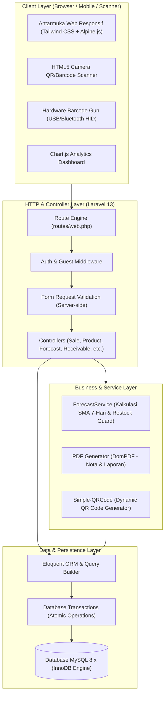
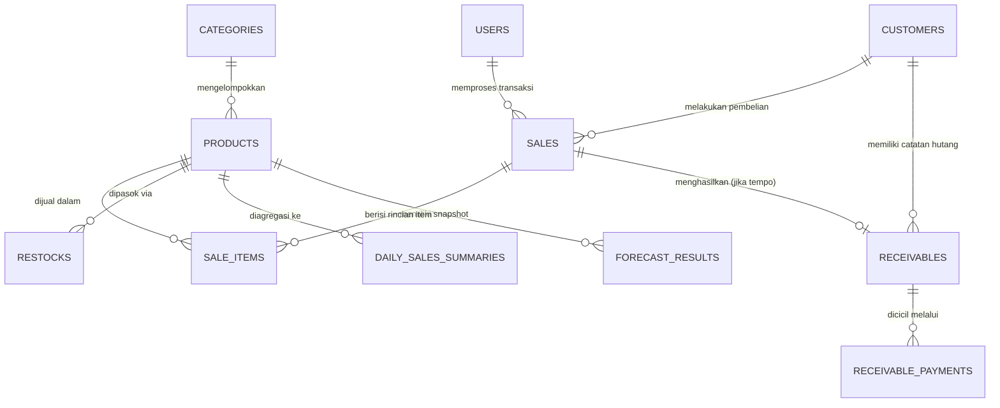

# Dokumen Arsitektur & Teknologi Sistem Informasi Toko Pertanian Al Barokah

**Sistem:** Point of Sale (POS), Inventori, Rekomendasi Restock (Demand Forecasting SMA), dan Pengelolaan Piutang  
**Studi Kasus:** Toko Pertanian Al Barokah  
**Versi Sistem:** 1.0 (Production-Ready)  
**Terakhir Diperbarui:** November 2026  

---

## 1. Ringkasan Eksekutif

Sistem Informasi Toko Pertanian Al Barokah dirancang untuk mendigitalkan seluruh rantai operasional ritel sarana produksi pertanian (saprotan), mulai dari transaksi kasir (*Point of Sale*), pencatatan inventori barang multi-kategori, pelacakan piutang petani dengan sistem angsuran fleksibel, hingga **Sistem Pendukung Keputusan (*Decision Support System*)** berbasis peramalan permintaan stok menggunakan algoritma **Single Moving Average (SMA)** 7-Hari.

Sistem dibangun dengan arsitektur **Monolith Modern (Laravel MVC)** yang mengedepankan performa tinggi, kesederhanaan *deployment*, integritas finansial berbasis transaksi atomik (*ACID*), serta antarmuka responsif yang ramah perangkat seluler (*mobile-first*) maupun desktop kasir.

---

## 2. Arsitektur Sistem (High-Level Architecture)

Aplikasi mengadopsi pola **Model-View-Controller (MVC)** dengan pemisahan lapisan bisnis eksplisit (*Service Layer*) untuk kalkulasi komputasi non-trivial:



### Karakteristik Arsitektur:
1. **Server-Side Rendered (SSR) dengan Micro-Interactivity:** Menggunakan Blade Templating yang dipadukan dengan Alpine.js untuk reaktivitas UI tanpa beban overhead SPA (*Single Page Application*) yang berat.
2. **Dedicated Service Layer:** Logika komputasi peramalan Single Moving Average (SMA) diisolasi di `App\Services\ForecastService` agar dapat digunakan ulang baik melalui Web Controller, CLI Artisan/Seeder, maupun Automated Test.
3. **Atomic Financial Transactions:** Setiap transaksi penjualan kasir (pengurangan stok, pembuatan nota, pembuatan item penjualan, pembuatan piutang jika tempo) dieksekusi di dalam `DB::transaction()` demi menjamin *data integrity* (tidak ada stok terpotong jika nota gagal tersimpan).

---

## 3. Komponen Teknologi Backend

| Teknologi / Komponen | Versi | Peran & Alasan Pemilihan |
| :--- | :---: | :--- |
| **PHP** | `^8.3` | Bahasa pemrograman utama. Memanfaatkan fitur modern seperti *Typed Properties*, *Match Expressions*, *Readonly Properties*, *Nullsafe Operator*, dan performa OPcache yang optimal. |
| **Laravel Framework** | `^13.x` | Kerangka kerja web MVC standar industri. Menyediakan Eloquent ORM, migrasi database skematik, validasi otomatis via Form Request, proteksi CSRF/XSS, dan sistem testing terintegrasi. |
| **Laravel Breeze** | `^2.4` | Modul otentikasi minimalis, aman, dan ringan berbasis sesi (*cookie-based session authentication*) dengan hashing password Bcrypt. |
| **barryvdh/laravel-dompdf** | `^3.1` | Pembangkit dokumen PDF untuk mencetak Nota Kasir format Thermal/A4, Laporan Penjualan, dan Laporan Rekapitulasi Piutang Petani. |
| **simplesoftwareio/simple-qrcode** | `^4.2` | Generator QR Code berbasis SVG/PNG untuk membuat kode unik produk yang dapat ditempel pada kemasan saprotan atau dicetak di struk belanja. |
| **Laravel Tinker** | `^3.0` | Antarmuka REPL interaktif berbasis PsySH untuk administrasi data, eksekusi query ad-hoc, dan verifikasi status database. |

---

## 4. Komponen Teknologi Frontend & UI/UX

| Pustaka / Alat | Versi | Peran & Alasan Pemilihan |
| :--- | :---: | :--- |
| **Tailwind CSS** | `^3.1` | Utility-first CSS framework untuk membangun desain kustom, responsif (*mobile-friendly*), dan konsisten dengan palet warna pertanian (Emerald, Forest Green, Amber, Slate). |
| **Alpine.js** | `^3.4.2` | Framework JavaScript deklaratif ultra-ringan (~15KB) untuk menangani interaktivitas sisi klien: kalkulasi keranjang kasir real-time, modal popup, filter pencarian instan, dan *accordion*. |
| **Vite** | `^8.0` | Bundler dan *build tool* generasi terbaru dengan *Hot Module Replacement* (HMR) berkecepatan tinggi untuk kompilasi CSS dan JavaScript. |
| **Chart.js** | `^4.5.1` | Visualisasi data interaktif pada Dashboard Eksekutif: grafik tren omset penjualan 14 hari terakhir dan komparasi transaksi tunai vs kredit. |
| **html5-qrcode** & **jsQR** | `^2.3.8` / `^1.4.0` | Pemindai QR & Barcode berbasis kamera web/HP langsung di browser tanpa instalasi aplikasi native, dilengkapi fitur *mirror inversion* (kamera depan laptop) dan opsi *switch* kamera belakang (ponsel). |

---

## 5. Basis Data & Model Data Relasional

Sistem menggunakan **MySQL 8.x** (dengan mesin penyimpanan **InnoDB**) pada lingkungan produksi/lokal, dan **SQLite In-Memory** pada lingkungan pengujian otomatis (*CI Testing*).

### Skema Entitas Inti



### Rincian Tabel dan Fungsinya:
1. **`users`**: Akun pengguna sistem (Owner/Admin kasir) dengan enkripsi password terproteksi.
2. **`categories`**: Klasifikasi saprotan (Pupuk, Insektisida, Herbisida, Fungisida, Benih, Alat Tani, dsb.).
3. **`products`**: Katalog 369 barang mencakup kode SKU, nama produk, satuan kemasan, barcode unik, harga beli, harga jual, stok fisik, dan batas stok minimum (`min_stock`).
4. **`sales` & `sale_items`**: Catatan transaksi penjualan, nomor faktur (`INV-YYYYMMDD-XXXX`), metode pembayaran (`cash` / `credit`), subtotal, dan total nilai transaksi.
5. **`receivables` & `receivable_payments`**: Pengelolaan piutang petani dengan pelacakan `total_amount`, `paid_amount`, `remaining_balance`, dan histori cicilan bertanggal.
6. **`daily_sales_summaries`**: Tabel agregasi penjualan harian per produk (`product_id` + `sale_date`) yang menjadi bahan mentah kalkulasi algoritma SMA 7-Hari.
7. **`forecast_results`**: Tabel *caching* snapshot hasil kalkulasi peramalan permintaan terkini (`forecast_value`, `actual_stock`, `status`, `shortage_qty`).
8. **`restocks`**: Riwayat pasokan barang masuk dari distributor/supplier.

---

## 6. Algoritma Demand Forecasting (Single Moving Average)

Sistem mengimplementasikan metode peramalan kuantitatif deret waktu **Single Moving Average (SMA)** untuk mengantisipasi kehabisan stok barang (*stock-out*).

### 6.1 Formula Matematika
Peramalan periode berikutnya $F_{t+1}$ dihitung dengan merata-ratakan penjualan aktual selama $n$ hari terakhir:

$$F(t+1) = \frac{\sum_{i=0}^{n-1} X_{t-i}}{n} = \frac{X_t + X_{t-1} + X_{t-2} + \dots + X_{t-n+1}}{n}$$

* **Konstanta Parameter ($n$):** Ditetapkan secara baku **7 hari** (`config('forecast.sma_window_days', 7)`), selaras dengan siklus belanja mingguan petani lokal.
* **Aturan Kecukupan Data (*Data Sufficiency Guard*):**  
  Forecast **hanya dihitung** jika produk memiliki minimal 7 hari data riwayat transaksi penjualan. Jika $< 7$ hari, sistem mengembalikan status `"insufficient_data"` (**Data Belum Mencukupi**) untuk mencegah distorsi statistik akibat data yang terlalu sedikit.

### 6.2 Evaluasi Kebutuhan Restok
Setelah nilai $F(t+1)$ didapatkan, sistem membandingkannya dengan stok fisik aktual di gudang:

$$\text{Status} = \begin{cases} \text{\textbf{Stok Aman}}, & \text{jika } S_{\text{aktual}} \ge F(t+1) \\ \text{\textbf{Perlu Restok}}, & \text{jika } S_{\text{aktual}} < F(t+1) \end{cases}$$

Jika statusnya adalah **Perlu Restok**, besaran kekurangan stok (*shortage*) dihitung dengan fungsi pembulatan ke atas (*ceiling*), mengingat satuan barang saprotan dijual utuh:

$$\text{Shortage} = \lceil F(t+1) - S_{\text{aktual}} \rceil$$

---

## 7. Mekanisme Keamanan & Integritas Transaksi

1. **Integritas Transaksi Finansial (ACID DB Transaction):**
   ```php
   DB::transaction(function () use ($request, $admin) {
       // 1. Simpan header penjualan (sales)
       // 2. Simpan rincian barang (sale_items)
       // 3. Potong stok produk secara atomik (decrement stock)
       // 4. Update agregasi penjualan harian (daily_sales_summaries)
       // 5. Buat piutang otomatis jika metode bayar kredit (receivables)
   });
   ```
   Jika terjadi kegagalan sistem pada salah satu langkah, seluruh perubahan akan di-*rollback* otomatis.
2. **Validasi Pelunasan Piutang Ketat:**
   Pembayaran angsuran divalidasi ketat di sisi server (`0 < nominal_bayar <= remaining_balance`). Saldo hutang tidak akan pernah bernilai negatif.
3. **Proteksi Akses & Web Security:**
   - Seluruh endpoint privat diisolasi dengan middleware `auth`.
   - Form submission dilindungi dari serangan *Cross-Site Request Forgery* (CSRF Token).
   - Seluruh output teks otomatis disanitasi oleh Blade Templating untuk mencegah *Cross-Site Scripting* (XSS).
   - Parameter pencarian menggunakan *Parameterized Query* PDO bawaan Eloquent untuk mencegah *SQL Injection*.

---

## 8. Kualitas Kode, Pengujian & CI/CD

### 8.1 Pengujian Otomatis (PHPUnit)
Sistem memiliki **112 test cases aktif** dengan **480 assertions** yang mencakup pengujian unit dan fitur:
* **7 Skenario Black Box PRD:** Pengujian autentikasi, transaksi kasir tunai/kredit, validasi stok habis, pelunasan piutang, kalkulasi SMA 7-Hari, dan ekspor laporan.
* **Testing Transaksi Atomik:** Memastikan *rollback* berjalan saat validasi pembayaran gagal.
* **Database Isolation:** Menggunakan trait `RefreshDatabase` untuk memastikan tiap pengujian berjalan di database bersih yang terisolasi.

### 8.2 Standardisasi Gaya Kode (Laravel Pint)
Kode mematuhi standar **PSR-12** dan konvensi resmi Laravel menggunakan linter terotomatisasi `laravel/pint`.

### 8.3 Integrasi Berkelanjutan (CI/CD - GitHub Actions)
Setiap `git push` dan *Pull Request* ke branch `main` diverifikasi secara otomatis melalui alur kerja GitHub Actions:
1. Validasi sintaks dan dependensi (`composer validate`).
2. Pemeriksaan gaya kode (`./vendor/bin/pint --test`).
3. Pengujian migrasi skema database.
4. Eksekusi pengujian otomatis seluruh suite (`php artisan test`).
5. Kompilasi build aset frontend Tailwind & Vite (`npm run build`).

---

## 9. Matriks Lengkap Dependensi & Pustaka

### Dependensi PHP (`composer.json`)
```json
{
    "require": {
        "php": "^8.3",
        "laravel/framework": "^13.17",
        "laravel/tinker": "^3.0",
        "barryvdh/laravel-dompdf": "^3.1",
        "simplesoftwareio/simple-qrcode": "^4.2"
    },
    "require-dev": {
        "fakerphp/faker": "^1.23",
        "laravel/breeze": "^2.4",
        "laravel/pint": "^1.27",
        "mockery/mockery": "^1.6",
        "phpunit/phpunit": "^12.5.12"
    }
}
```

### Dependensi JavaScript / NPM (`package.json`)
```json
{
    "dependencies": {
        "chart.js": "^4.5.1",
        "html5-qrcode": "^2.3.8",
        "jsqr": "^1.4.0"
    },
    "devDependencies": {
        "alpinejs": "^3.4.2",
        "tailwindcss": "^3.1.0",
        "@tailwindcss/forms": "^0.5.2",
        "@tailwindcss/vite": "^4.0.0",
        "vite": "^8.0.0",
        "laravel-vite-plugin": "^3.1",
        "postcss": "^8.4.31",
        "autoprefixer": "^10.4.2"
    }
}
```

---

## 10. Kesimpulan

Tumpukan teknologi (*technology stack*) yang dipilih untuk Sistem Informasi Toko Pertanian Al Barokah menyeimbangkan **kecepatan pengembangan**, **keandalan operasional**, **kemudahan pemeliharaan**, dan **efisiensi sumber daya**.

Dengan kombinasi Laravel 13, Tailwind CSS, Alpine.js, algoritma Single Moving Average terisolasi, serta pemindai barcode kamera mandiri, sistem ini siap digunakan di lapangan secara stabil baik pada perangkat PC kasir maupun smartphone operasional toko.
